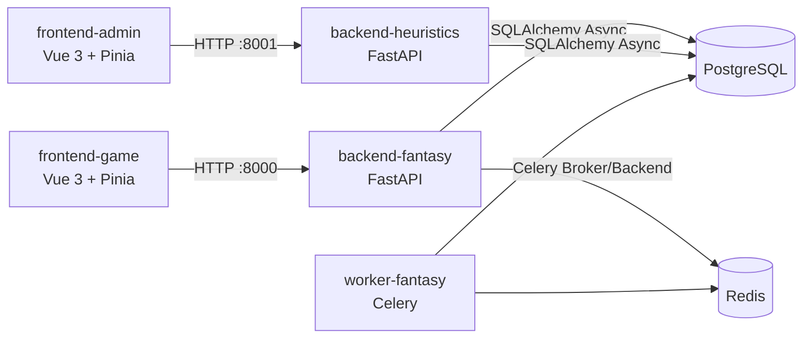

# Fantasy FiveM Platform

Plataforma full-stack para economia de cards e moderação heurística em servidores FiveM.

O repositório está organizado em quatro aplicações principais:

- `backend-fantasy`: API do jogo (inventário, packs, forja, mercado e esquadrão).
- `backend-heuristics`: API administrativa (painel de monitoramento e webhook de eventos).
- `frontend-game`: cliente Vue para jogadores.
- `frontend-admin`: cliente Vue para operação/admin.

## Documentação Técnica

As páginas detalhadas estão em [`docs/`](./docs):

- [Arquitetura](./docs/architecture.md)
- [Mapa de Módulos](./docs/modules.md)
- [Fluxos do Sistema](./docs/system-flows.md)
- [Fluxos e Módulos (consolidado)](./docs/fluxos-e-modulos.md)
- [Mapa de APIs](./docs/api-map.md)
- [Relatório de Auditoria](./docs/audit-report.md)

## Arquitetura Resumida



## Stack

- Backend: Python 3.11, FastAPI, SQLAlchemy 2, Alembic, Celery, Redis.
- Frontend: Vue 3, Pinia, Vue Router, Vite, Tailwind.
- Infra local: Docker Compose (PostgreSQL 15 + Redis 7 + 4 apps).

## Subindo Localmente

### Pré-requisitos

- Docker e Docker Compose.

### Comandos

```bash
docker compose up --build
```

### Endpoints locais

- Jogo (frontend): `http://localhost:5173`
- Admin (frontend): `http://localhost:5174`
- API jogo: `http://localhost:8000`
- API heurística: `http://localhost:8001`
- PostgreSQL: `localhost:5432`
- Redis: `localhost:6379`

## Variáveis de Ambiente

Arquivos usados no ambiente local:

- `backend-fantasy/.env`
- `backend-heuristics/.env`
- `frontend-game/.env`
- `frontend-admin/.env`

As variáveis obrigatórias e seus papéis estão descritos em [Arquitetura](./docs/architecture.md).

## Estado Atual da Base (Resumo)

A auditoria técnica identificou inconsistências importantes em autenticação, acoplamento entre front/back e migrações. O detalhamento com criticidade e plano de correção está em [Relatório de Auditoria](./docs/audit-report.md).

## Estrutura do Repositório

```text
.
├── backend-fantasy/
├── backend-heuristics/
├── frontend-game/
├── frontend-admin/
├── docker-compose.yaml
└── docs/
```
