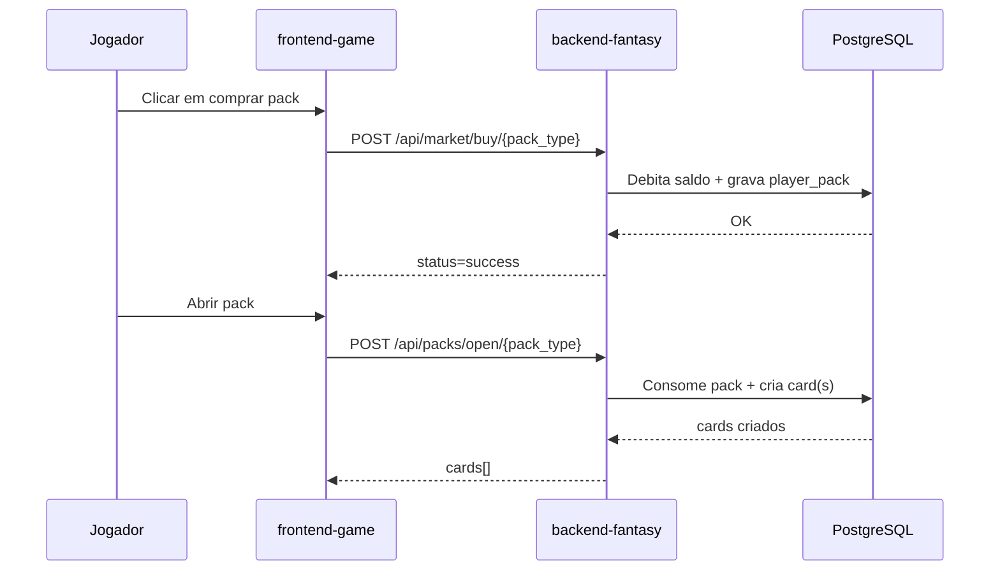

# Fluxos do Sistema

Este documento mapeia os fluxos ponta a ponta e os módulos envolvidos.

## 1. Autenticação de Jogador (Dev Login)

1. Usuário acessa `frontend-game` (`/login`).
2. `Login.vue` chama `GET /api/auth/dev-login/{steam_id}`.
3. `backend-fantasy/routers/auth.py` busca/cria jogador em `players`.
4. API retorna JWT.
5. Front salva token em `localStorage`.
6. `App.vue`/`store.fetchProfile()` chamam `GET /api/user/me/profile`.
7. `routers/users.py` valida token e retorna perfil.

Módulos:

- `frontend-game/src/views/Login.vue`
- `frontend-game/src/stores/fantasy.js`
- `backend-fantasy/routers/auth.py`
- `backend-fantasy/routers/users.py`

## 2. Compra de Pack na Loja Oficial

1. `Market.vue` busca cotações (`GET /api/market/store`).
2. Usuário clica em comprar.
3. Front envia `POST /api/market/buy/{pack_type}` com `expected_price`.
4. Backend recalcula preço dinâmico e valida concorrência.
5. Saldo do jogador é debitado e `player_packs` atualizado.
6. Front atualiza carteira e inventário de packs.

Módulos:

- `frontend-game/src/views/Market.vue`
- `backend-fantasy/routers/market.py`

## 3. Abertura de Pack

1. `Deck.vue` lista packs (`GET /api/packs/user/me`).
2. Ao abrir, chama `POST /api/packs/open/{pack_type}`.
3. Backend decrementa pack, sorteia raridade(s) e cria card(s) em `cards`.
4. Front renderiza animação de reveal e recarrega deck/packs.

Módulos:

- `frontend-game/src/views/Deck.vue`
- `backend-fantasy/routers/packs.py`

## 4. Forja de Cards

1. Jogador seleciona 5 cards no deck.
2. Front envia `POST /api/cards/forge` com `card_ids` e `boost_coins`.
3. Backend valida posse e restrições (não estar em operação/esquadrão).
4. Backend calcula custo e probabilidades por peso de raridade + boost.
5. Remove 5 cards e cria 1 novo card forjado.
6. Front mostra animação e atualiza saldo/inventário.

Módulos:

- `frontend-game/src/views/Deck.vue`
- `backend-fantasy/routers/cards.py`

## 5. Contrato (Staking)

1. No modal do card, usuário escolhe duração (3/7/14 dias).
2. Front chama `POST /api/cards/{card_id}/contract`.
3. Backend valida card e estado.
4. Define `contract_end_date` e `contract_yield`.

Módulos:

- `frontend-game/src/components/CardDetailsModal.vue`
- `backend-fantasy/routers/cards.py`

## 6. Gestão de Esquadrão

1. `Squad.vue` carrega cards do usuário.
2. Para alocar: `POST /api/squad/deploy/{card_id}` com `position` e `role`.
3. Backend garante posição válida e role permitida.
4. Se slot ocupado, remove ocupante atual.
5. Para remover: `POST /api/squad/remove/{card_id}`.

Módulos:

- `frontend-game/src/views/Squad.vue`
- `backend-fantasy/routers/squad.py`

## 7. Mercado P2P e Leilão

1. Front lista anúncios (`GET /api/market/p2p`).
2. Vendedor anuncia card (`POST /api/market/p2p/sell/{card_id}`).
3. Comprador compra direto (`POST /api/market/p2p/buy/{listing_id}`) ou licita (`POST /api/market/p2p/bid/{listing_id}`).
4. Backend transfere saldo, propriedade e estado do anúncio.

Módulos:

- `frontend-game/src/views/Market.vue`
- `backend-fantasy/routers/market.py`

## 8. Dark Web

1. Front verifica status (`GET /api/market/darkweb/status`).
2. Se ativo, usuário compra (`POST /api/market/darkweb/buy`).
3. Backend valida janela temporal, saldo e entrega pack `CLASSIFIED`.

Módulos:

- `frontend-game/src/views/Market.vue`
- `backend-fantasy/routers/market.py`

## 9. Operação Administrativa

1. Operador acessa `frontend-admin` e envia senha (`POST /api/admin/login`).
2. Dashboard consulta suspeitos (`GET /api/admin/suspects`).
3. Operador dispara ações de simulação/limpeza/consulta de dossiê.

Módulos:

- `frontend-admin/src/views/AdminLogin.vue`
- `frontend-admin/src/views/AdminDashboard.vue`
- `backend-heuristics/routers/admin.py`

## 10. Ingestão de Evento de Partida (Heurística)

1. Serviço externo chama `POST /api/webhook/match_event`.
2. `backend-heuristics/routers/webhook.py` lê payload e atualiza `suspicion_score`.
3. Resultado é refletido em `/api/admin/suspects`.

Módulos:

- `backend-heuristics/routers/webhook.py`
- `backend-heuristics/routers/admin.py`

## 11. Fluxo Assíncrono (Celery)

Fluxo realtime implementado no domínio de heurística:

1. Worker de heurística recebe task `process_match_event`.
2. Regras anti-cheat calculam `suspicion_score` e podem alertar Discord.
3. Worker envia task `fantasy.process_xp`.
4. Task de fantasy atualiza XP/kills/headshots das cartas.
5. Fantasy publica updates em Redis (`ws_card_updates`).

## 12. Auditoria Noturna (Celery Beat + Z-Score)

1. Celery Beat do domínio heurístico agenda `tasks.analyze_global_deviations` (04:00 UTC).
2. Task varre `player_stats` com mínimo de kills.
3. Calcula média + desvio padrão de HS-rate global.
4. Marca contas fora do intervalo e dispara alertas de auditoria.

Observação:

- Para ativar auditoria noturna, é necessário processo `celery beat` do serviço heurístico.

## Sequência resumida (exemplo: compra + abertura)

